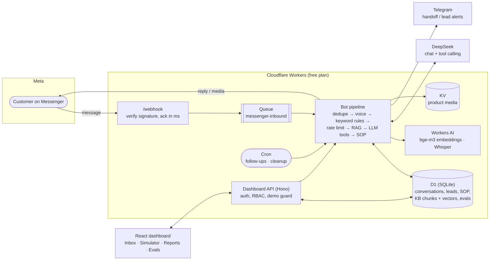

# Messenger AI Desk

An AI customer-service desk for Facebook Messenger that runs entirely on the **Cloudflare Workers free plan**.
A customer messages your Page, an LLM agent answers from your product catalogue and knowledge base, walks the customer through a sales SOP, collects leads, and hands off to a human when it should. Staff work from a web dashboard (中文 / English).

**Live demo:** https://messenger-ai-cs-demo.yonghaomah.workers.dev — opens straight in, no sign-up. It runs on its own Worker and database with fictional property data, resets every day, and is read-only except for chatting with the bot in the Simulator and running the evals.

中文部署教程：[README.zh-CN.md](README.zh-CN.md)

## What it does

| Area | Details |
| --- | --- |
| **AI replies** | DeepSeek (any OpenAI-compatible API) with tool calling: `save_lead`, `handoff_to_human`, `get_product`, `send_media`, `set_stage` |
| **Grounding** | Answers only from the product catalogue and knowledge base (paste text, PDF, Word). No price in the data means the bot will not quote one |
| **Sales SOP** | Staged playbook (e.g. needs → recommend → objections → close). The agent tracks each customer's stage and can send stage-specific images or videos |
| **Human handoff** | Keyword rules and model-initiated handoff, Telegram alerts, shared Inbox, auto-resume after N hours, quick replies |
| **Voice** | Voice messages are transcribed with Whisper before the agent answers; a fixed fallback reply is used when transcription fails |
| **Follow-ups** | Up to two automatic nudges inside Meta's 24-hour window, with per-stage scripts |
| **Simulator** | Play the customer inside the dashboard. Same pipeline as real traffic, no Meta App required |
| **Per-reply trace** | Every bot reply records the retrieved passages, tool calls, stage change, tokens and latency |
| **Reports** | Messages per day, lead rate, bot-only vs human-involved conversations, SOP funnel, AI latency and token use |
| **AI evals** | A fixed regression set with rule checks (must hand off, must contain, no price, must save lead) and an LLM judge; one click shows the pass rate |
| **Public demo** | A separate deployment with its own database and API key, server-enforced read-only, daily AI budget, reset every night |

## Architecture



A static copy of the diagram is in [`docs/architecture.png`](docs/architecture.png).

### How one message is handled

1. **Webhook** checks `X-Hub-Signature-256`, splits the payload into jobs, enqueues them and returns `200` immediately. Meta retries slow webhooks, so no AI work happens here.
2. **Queue consumer** processes jobs in order. Each message id is recorded first, so a redelivery is a no-op. If the job fails before anything was sent to the customer, the record is removed and the queue retries; after a reply has gone out it is never retried, so customers do not get duplicates.
3. **Rules before the model.** Handoff and forbidden keywords, the human-takeover flag and a per-customer rate limit are plain code. They are cheap, and they cannot be talked out of their job by a prompt.
4. **Retrieval.** Knowledge-base chunks are embedded with `bge-m3` and stored in D1; similarity is computed in the Worker. A small knowledge base is sent whole; if embeddings are unavailable it falls back to keyword search.
5. **Agent loop.** Up to four rounds of tool calls. Tools only write to the database in the live path; the Simulator's test chat and the eval runner reuse the same loop without side effects.
6. **Trace.** The reply is stored with what was retrieved, which tools ran, tokens and latency. The Inbox shows this under each bot message, and Reports aggregate it.

## Design decisions

- **Free-plan constraints shaped the design.** Workers allow 10 ms of CPU per request and a limited number of subrequests. Waiting on an LLM is not CPU time, so the agent fits; long jobs are split instead: the eval page runs one case per request, and the demo seeder inserts each table with a single `json_each` statement.
- **No vector database.** Vectorize is not on the free plan, so vectors live in D1 as blobs. This is fine up to a few hundred chunks per workspace, and it is the first thing to replace at scale.
- **Multi-tenant from the first migration.** Every table carries `workspace_id`, so one deployment can serve several businesses.
- **The public demo is a separate deployment, not a separate login.** Same code, deployed twice: `wrangler.jsonc` for the real site and `wrangler.demo.jsonc` for the demo. The demo Worker is bound only to its own D1 database and has its own low-budget LLM key, no Page token and no Telegram token. Even a full compromise of the demo exposes fictional data only. The real site's login page is not linked from anywhere.
- **The demo is read-only on the server.** A demo session may call a short allow-list of write routes (create a simulated customer, send a simulated message, run evals). Everything else returns `403` before reaching a handler. Visitors cannot supply their own LLM endpoint, AI calls stop at a daily cap, entering the demo is rate-limited per IP, and a nightly cron wipes and reseeds it.
- **Login hardening.** Five failed logins lock an account for 15 minutes; twenty failures from one IP lock that IP for 30 minutes. Writes require a custom header (CSRF), sessions are HttpOnly cookies, and responses carry `X-Frame-Options` / `nosniff` headers.
- **Secrets.** Page tokens and API keys are encrypted with AES-GCM before they are stored, passwords use PBKDF2, and deployment secrets live in Cloudflare (`wrangler secret`), never in the repo. The real site's `wrangler.jsonc` is git-ignored; `wrangler.example.jsonc` is the template.
- **Meta policy.** Replies respect the 24-hour messaging window, the bot says it is automated when asked, and a human can always be requested.

## Evals

The eval set is how prompt, SOP and knowledge-base changes are checked for regressions. Each case is a customer message plus expectations:

| Check | Example |
| --- | --- |
| Handoff must / must not happen | "I want a refund" → must hand off |
| Reply must contain / must not contain | "How much is the 3-bedroom?" → must contain `488,000` |
| No price quoted | Asking about a product that does not exist |
| Lead must be saved | Customer gives a name and phone number |
| LLM judge | "Did not promise any discount" |

Rule checks are deterministic. The LLM judge covers behaviour that string matching cannot, and its verdict is shown with its one-line reason.

## Tech stack

Cloudflare Workers · Hono · D1 · Queues · KV · Workers AI (`bge-m3`, `whisper-large-v3-turbo`) · Cron Triggers · DeepSeek · React 19 + Vite · TypeScript

## Project layout

```
migrations/            D1 schema (every table has workspace_id)
src/worker/
  index.ts             routes, queue consumer, cron
  webhook.ts           Meta webhook: verify signature → enqueue
  bot.ts               message pipeline and the agent loop
  kb.ts                chunking, embeddings, retrieval
  followup.ts          automatic follow-ups
  voice.ts             Whisper transcription
  insights.ts          reports and the eval runner
  demo.ts              public demo: seed data, daily quota, nightly reset
  throttle.ts          login / demo-entry rate limiting
  api.ts / auth.ts     dashboard API, sessions, roles
src/shared/            settings, industry templates, eval types (shared by worker and web)
src/web/               React dashboard
test/                  end-to-end tests against a mock Meta Graph API + LLM
docs/                  architecture diagram
wrangler.example.jsonc template for your own deployment (copy to wrangler.jsonc)
wrangler.demo.jsonc    the public demo deployment
```

## Run locally

```bash
npm install
cp wrangler.example.jsonc wrangler.jsonc
cp .dev.vars.example .dev.vars     # fill in test values
npm run db:migrate:local
npm run dev                        # http://localhost:8787
```

Workers AI is not available locally, so retrieval falls back to keyword search.

## Tests

```bash
npm test
```

`test/run.mjs` builds the dashboard, starts a mock Meta Graph API and a mock OpenAI-compatible LLM, and runs each suite against a fresh local D1 database: 185 checks across the webhook and queue pipeline, handoff rules, products and media, SOP stages, voice, follow-ups, reports, evals, login lockout, and the demo site's read-only guard and daily cap. They also run in GitHub Actions on every push.

## Deploy

```bash
cp wrangler.example.jsonc wrangler.jsonc
npx wrangler d1 create messenger-ai-cs
npx wrangler queues create messenger-inbound
npx wrangler kv namespace create MEDIA     # put both ids into wrangler.jsonc
npm run db:migrate:remote
npx wrangler secret put META_APP_SECRET
npx wrangler secret put META_VERIFY_TOKEN
npx wrangler secret put ENCRYPTION_KEY
npx wrangler secret put SETUP_KEY
npm run deploy
```

Then open the site, create the owner account with your `SETUP_KEY`, add a DeepSeek API key under **System**, and try the **Simulator**.

The public demo is a second deployment:

```bash
npx wrangler d1 create messenger-ai-cs-demo   # put the id into wrangler.demo.jsonc
npm run db:migrate:demo
npx wrangler secret put DEMO_DEEPSEEK_KEY -c wrangler.demo.jsonc
npm run deploy:demo
``` Connecting a real Page needs a Meta App with the Messenger product and, for the public, App Review for `pages_messaging`. The step-by-step guide is in [README.zh-CN.md](README.zh-CN.md).

## Status and limits

- The Meta webhook path is covered by the end-to-end tests against a mock Graph API. It has not yet been run against a live Facebook Page, because the Meta App is still to be created.
- Voice transcription quality for mixed Mandarin / English / Malay audio has not been measured.
- The SOP funnel uses each customer's current stage, so "reached stage N" means "is now at stage N or later".
- Free-plan ceilings: roughly 3,000 customer messages a day (Queues), 25 MB per media file.
